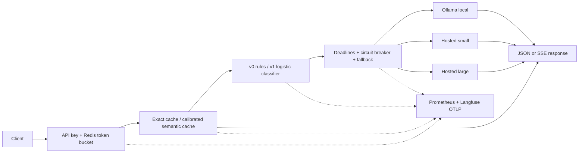

# Intelligent LLM Gateway

An OpenAI-compatible, streaming gateway with API-key authentication, atomic Redis rate limiting, exact/semantic caching, rule-based and learned routing, bounded fallback, circuit breakers, Prometheus metrics and Langfuse-compatible tracing.

**Model families:** native **Claude** and **Gemini**, hosted **Qwen** and **DeepSeek** through compatible endpoints, GPT, and local Ollama models. OpenAI compatibility describes the client-facing API; the backend is configurable. See the [provider catalog](config/providers.yaml) and [compatibility guide](docs/providers.md).

**Status:** implemented and locally tested in an isolated Python 3.11 `.venv`. The demo runs without credentials. Real-model profiling, production cache calibration, trained-model accuracy and a Grafana screenshot require the external services described below. Docker and Ollama were not installed in the build environment.

The improved plan is in **[PLAN.md](PLAN.md)**. Important improvements include held-out evaluation, tenant-safe caching, explicit streaming failure semantics, separate input/output pricing and honest benchmark provenance.

**Understand the project:** [How it works and what to improve next](docs/how-it-works.md) explains the complete request lifecycle, provider adapters, caching, routing, streaming, reliability, testing and a prioritized improvement roadmap.



## Quick start — Windows

The project-local `.venv` has already been created and dependencies installed. From this folder:

```powershell
& ".venv\Scripts\python.exe" -m gateway.cli serve --config config/demo.yaml
```

- API: <http://127.0.0.1:8000>
- Interactive documentation: <http://127.0.0.1:8000/docs>
- Demo API key: `demo-key-change-me`

In another PowerShell window:

```powershell
$body = @{model="auto"; messages=@(@{role="user"; content="What is a gateway?"})} | ConvertTo-Json -Depth 8
Invoke-RestMethod -Uri "http://127.0.0.1:8000/v1/chat/completions" -Method Post -Headers @{Authorization="Bearer demo-key-change-me"} -ContentType "application/json" -Body $body
```

Streaming with curl (Bash example; use `curl.exe` rather than the PowerShell alias on Windows):

```bash
curl -N http://127.0.0.1:8000/v1/chat/completions \
  -H 'Authorization: Bearer demo-key-change-me' \
  -H 'Content-Type: application/json' \
  -d '{"model":"auto","messages":[{"role":"user","content":"Hello"}],"stream":true,"stream_options":{"include_usage":true}}'
```

For a fresh checkout:

```powershell
py -3.11 -m venv .venv
& ".venv\Scripts\python.exe" -m pip install -c constraints.txt -e ".[dev,eval]"
```

Linux/macOS equivalent: `python3.11 -m venv .venv`, then `.venv/bin/python -m pip install -c constraints.txt -e '.[dev,eval]'`. Commands below use installed `gateway` / `gateway-eval`; activate `.venv` or invoke `.venv\Scripts\gateway.exe` / `.venv\Scripts\gateway-eval.exe` directly.

## Real APIs now — native setup

Use **[config/providers.yaml](config/providers.yaml)** for Claude/Gemini/Qwen/DeepSeek and other configured tiers. For example, start with a Gemini key:

```powershell
$env:GEMINI_API_KEY = "your-gemini-key"
$env:REDIS_URL = "redis://localhost:6379/0"
& ".venv\Scripts\python.exe" -m gateway.cli serve --config config/providers.yaml
```

This requires a reachable Redis instance and a generated gateway client key in `config/keys.json`. Send `model: "gemini"`; other catalog aliases include `claude`, `qwen`, `deepseek`, `gpt` and `local`. Only selected tiers need credentials. Ollama is required for the local tier, semantic embeddings and v1; explicit hosted requests with semantic caching/v1 disabled can run without it. Redis can run natively/in WSL or be managed remotely. The credential-free demo remains available while those are being arranged. [config/native.yaml](config/native.yaml) retains the original local + small/large OpenAI example.

**Your API does not have to stay the same throughout the project.** Keys and providers are configurable per tier. One provider/key can serve both hosted models, or each tier can have its own. Changing models requires updating benchmarks and trained routing artifacts. See **[API switching and native setup](docs/providers.md)** for the complete procedure.

## Docker Compose — prepared for later

Docker execution is deferred by request. The Dockerfile, Compose services, secret exclusions, config mounts and monitoring provisioning are prepared; image build/start validation will happen when Docker is introduced.

With Docker installed, one command starts the **demo gateway**, Redis, Prometheus and Grafana:

```bash
docker compose up --build -d
```

Grafana: <http://localhost:3000>, credentials `admin` / `gateway-local-demo`. The gateway dashboard is provisioned automatically. Prometheus: <http://localhost:9090>. Services bind to loopback by default.

To use real providers:

1. Run `gateway keygen --id client-1`. Save the secret and place the printed record inside a JSON array in `config/keys.json`; see [the example](config/keys.example.json).
2. Create `.env` using [`.env.example`](.env.example). Set `GATEWAY_CONFIG=config/gateway.yaml`, `OPENAI_API_KEY` and your Grafana password. Compose reads `.env`; native Python processes use shell environment variables.
3. Run `docker compose --profile models up --build -d`. The model initializer pulls the provisional Qwen local model and `all-minilm`; first use requires those downloads to finish.
4. Inspect `docker compose logs model-init` and make a request using your generated gateway secret.

For the multi-provider catalog, set `GATEWAY_CONFIG=config/providers.yaml` and the selected providers' keys instead. Compose passes those keys through and resolves Ollama's native/container hostname using `OLLAMA_BASE_URL`.

Production config requires Redis and hashed credentials. `config/providers.yaml` and `config/native.yaml` work natively and with Compose's endpoint override; `config/gateway.yaml` is the original Compose-specific example.

## API and behavior

| Endpoint | Purpose |
| --- | --- |
| `POST /v1/chat/completions` | Chat completion; JSON or SSE |
| `GET /v1/models` | Authenticated alias list with effective per-tier capabilities |
| `GET /health/live` | Process liveness and demo/production mode |
| `GET /health/ready` | State-store readiness; does not generate paid backend requests |
| `GET /metrics` | Prometheus scrape endpoint |
| `GET /docs` | Interactive OpenAPI documentation |

- Text messages; one choice per request (`n=1`). Native Claude/Gemini and compatible hosted adapters translate tool calls and model-supported structured output. Provider-specific constraints are documented and rejected explicitly. Details: [protocol contract](docs/architecture.md#protocol-contract) and [provider features](docs/providers.md#feature-compatibility).
- Default generation budget: 256 tokens. Parameters, aliases, prices, cache policy, deadlines and routing thresholds are configurable in YAML.
- Capability preflight filters unsupported tools, output formats, sampling controls and configured output/context budgets before cache or model calls. Context checks use a documented byte-based estimate. See [capability-aware routing](docs/capability-routing.md).
- Set `"routing":{"mode":"strict"}` with an explicit model alias to pin it. Set `"routing":{"fallbacks":["gemini","deepseek"]}` to narrow allowed alternatives; with `auto`, this list bounds the whole candidate pool. These controls are part of cache identity and are never sent to providers.
- Rate bucket: capacity **20**, refill **2 requests/second**, per API key. It runs before cache lookup. Requests above quota receive HTTP 429 and `Retry-After`.
- Exact cache entries are isolated by API-key identity and every request/model setting. Semantic matching is disabled until calibrated, and limited to single-user, deterministic, tool-free requests. Multi-turn requests can still use exact caching.
- Up to **two fallback attempts**, visiting distinct configured tiers. Fallback is allowed before the first backend output. After output starts, failure produces `data: {"error": ...}` followed by `data: [DONE]`; clients must check error frames, not just HTTP 200.
- Response headers include `X-Request-ID`, `X-Cache` and, for uncached completions, `X-Gateway-Tier`. Streaming cache hits replay the saved response without simulated token delays.
- One gateway process per container: circuit breakers and concurrency admission are process-local; rate limits and cache state are shared in Redis.

## Verified local results

These are **demo/injection measurements**, using deterministic mock backends over real loopback HTTP on the current Windows/Python 3.11 environment. They measure the test pipeline and gateway behavior, not Ollama throughput or production capacity. Demo load disables caching and raises its test-only rate quota.

These tables preserve the initial baseline run, before capability preflight was added. Rerun the documented load commands for performance measurements of the current version.

### Streaming load

400 requests **per level**, 1,600 total; all-request percentiles:

| Concurrent users | N | Requests/s | p50 (s) | p95 (s) | Error rate |
| --- | ---: | ---: | ---: | ---: | ---: |
| 5 | 400 | 365.55 | 0.0129 | 0.0138 | 0% |
| 10 | 400 | 305.53 | 0.0263 | 0.0493 | 0% |
| 20 | 400 | 111.10 | 0.1278 | 0.3353 | 0% |
| 40 | 400 | 66.66 | 0.2696 | 1.9729 | 0% |

Concurrency increased event-loop/client overhead on this machine. Run the same harness against real tiers before choosing deployment limits. Local raw records and generated tables: `results/demo-load.jsonl`, `results/demo-load.md`.

### Failure injection

The same seed assigns **80 of 400 requests (20%)** a fault, equally split between 500, 429, slow first output, pre-output disconnect and post-output disconnect. Ten concurrent users, circuit breaker enabled in both cases:

| Fallback | N | Successes | Error rate | p95 all requests (s) | p95 successes (s) |
| --- | ---: | ---: | ---: | ---: | ---: |
| Off | 400 | 314 | 21.5% | 0.0380 | 0.0403 |
| On | 400 | 384 | 4.0% | 0.0577 | 0.0579 |

Circuit skips and deadlines can affect more requests than the scheduled faults. Fallback adds work, so lower error rate does not imply lower latency. The surviving 4% correspond to post-output disconnects. Local raw records: `results/demo-failures.jsonl`.

### Six local-model configurations — empirical gate pending

The resumable **6 × 40 = 240-job pipeline was smoke-tested with mock adapters**. The following real-model metrics remain unmeasured:

| Configuration | TTFT | Tokens/s | Peak model-process RSS | Quality |
| --- | --- | --- | --- | --- |
| Llama 3.2 3B, Q4_K_M | Pending | Pending | Pending | Pending |
| Llama 3.2 3B, Q5_K_M | Pending | Pending | Pending | Pending |
| Qwen 2.5 1.5B, Q4_K_M | Pending | Pending | Pending | Pending |
| Qwen 2.5 1.5B, Q5_K_M | Pending | Pending | Pending | Pending |
| Gemma 2 2B, Q4_K_M | Pending | Pending | Pending | Pending |
| Gemma 2 2B, Q5_K_M | Pending | Pending | Pending | Pending |

**Provisional local tier:** Qwen 2.5 1.5B Q4_K_M, chosen as a smaller initial download/memory target within the candidate set. This is an operational default, not a benchmark winner. Promote a measured winner using the [evaluation runbook](docs/evaluation.md).

**Other pending empirical gates:** real-embedding cache threshold/hit rate; real paired-answer v0/v1 cost/agreement curve; hosted p95-derived deadlines; production load table; actual Grafana screenshot. The dashboard JSON and reproducible scripts are included. No screenshot or production-quality scores have been fabricated.

## Evaluation commands

```bash
# No paid calls: exported seed datasets, mock smoke tests, failure injection, loopback load
gateway-eval datasets
gateway-eval profile --demo --output results/demo-profile.jsonl
gateway-eval profile-report --input results/demo-profile.jsonl --output results/demo-profile-summary
gateway-eval cache-sweep --demo --output results/demo-cache
gateway-eval failures --requests 400 --fault mixed --output results/demo-failures
gateway-eval load --demo --users 5 10 20 40 --requests 400 --output results/demo-load

# Real Ollama models must be pulled first; pass the host Ollama PID to measure process RSS
gateway-eval profile --ollama-pid YOUR_PID --output results/profile.jsonl
gateway-eval grade --input results/profile.jsonl --output results/profile-grades.jsonl
gateway-eval profile-report --input results/profile.jsonl --grades results/profile-grades.jsonl --timeout-config results/timeouts.json
gateway-eval cache-sweep --model all-minilm

# Paid hosted generation/grading; configure tiers and use an expanded suite for real training
gateway-eval collect --tiers local large
gateway-eval grade
gateway-eval pair
gateway-eval train-router
```

Full instructions, threshold selection, safe resume, pricing calculations, sample limitations and how to enable v1: **[docs/evaluation.md](docs/evaluation.md)**.

### Pricing

Standard uncached input/output prices per million tokens, [verified on 2026-10-03](https://developers.openai.com/api/docs/pricing):

| Hosted tier | Model | Input | Output |
| --- | --- | ---: | ---: |
| Small | `gpt-4o-mini` | $0.15 | $0.60 |
| Large | `gpt-4o` | $2.50 | $10.00 |

Example only: 700 input + 200 output tokens per request, 65% routed to hosted small yields **$1.45875/1,000** versus **$3.75 always-large**, a **61.1%** reduction. Real curves use each measured answer's input/output usage. Local token pricing defaults to zero and excludes electricity/hardware; cached-provider-input discounts and invisible failed-attempt billing are also excluded.

## Observability

Prometheus exports per-tier outcomes, latency and TTFT histograms, tokens, configured costs, cache results, fallback/circuit skips, capability rejections/reroutes and rate-limit rejections. [Grafana dashboard JSON](ops/grafana/dashboard.json) includes sample counts beside percentile charts.

To enable Langfuse, set `OTEL_EXPORTER_OTLP_TRACES_ENDPOINT` to your instance's `/api/public/otel/v1/traces` endpoint, plus `LANGFUSE_PUBLIC_KEY` and `LANGFUSE_SECRET_KEY`. Chat requests entering the handler have auth, rate-limit, capability, cache, router and backend spans as applicable; router spans include v1 probability. Raw prompts, responses and API keys are omitted from traces.

After running the Docker stack and live traffic, open the provisioned dashboard and save an actual screenshot as `docs/dashboard.png`; then link it here. A real screenshot is pending because Docker was unavailable during the build.

## Tests

```powershell
& ".venv\Scripts\python.exe" -m pytest -q
& ".venv\Scripts\python.exe" -m ruff check gateway experiments tests
& ".venv\Scripts\python.exe" -m pip check
```

Tests cover exact bucket arithmetic, concurrent Lua behavior, cache boundaries and TTL, auth, SSE/tool calls, retry limits, circuit recovery, backend errors, JSON scoring, threshold selection, cost math and held-out router splitting. `TEST_REDIS_URL` enables an additional real-Redis integration test; CI provisions that service. The local suite uses fakeredis with Lua otherwise.

Local verification: **96 tests passed, 1 real-Redis integration test skipped** because no Redis server was available. This includes capability-aware selection, strict pinning/allowlists, cache-policy isolation, v1 capability checks, simulated Claude/Gemini/Qwen/DeepSeek protocols, cross-provider fallback, signed tool-context round-trips, trace correlation, live HTTP disconnect cleanup and dashboard metric references. Ruff and dependency consistency checks also passed. Live hosted-API verification awaits credentials; Docker image startup remains deferred, and external Langfuse ingestion requires its service.

## Repository map

```text
gateway/             API, adapters, cache, router, Redis state, reliability, telemetry
experiments/         Datasets, profiling, grading, calibration, training, load and faults
config/              Production/demo configs, six-model profile and key-file example
data/rubric.md       Versioned grading rubric
ops/                 Prometheus and provisioned Grafana dashboard
tests/               Behavior and integration tests
docs/                Design decisions and reproducible evaluation runbook
results/             Local generated JSONL, CSV, Markdown and SVG reports (gitignored)
artifacts/           Trained router JSON coefficients (gitignored)
.venv/               Isolated Python environment (gitignored)
```
